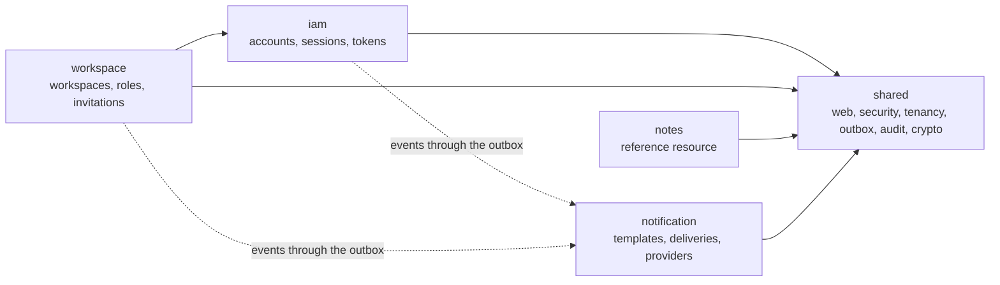

# Warden

[](https://github.com/kaulinmindiola/warden/actions/workflows/ci.yml)

Workspace identity, access & notification platform: a Spring Boot modular monolith that registers
and authenticates users, authorizes every request against the caller's current role in a
workspace, and notifies security and business events by e-mail.

A multi-workspace API needs more than a framework's defaults. A valid token must never cross into
another workspace, a stolen session must stop working at once, and a password reset e-mail must
not be lost because a provider is down. Warden makes these properties explicit and proves each one
with automated tests that reproduce the attack or the failure:

| ID | Guarantee |
|----|-----------|
| G-01 | **Isolation:** a valid token never grants access to data of a workspace its holder does not belong to. |
| G-02 | **Containment:** a compromised session can be terminated immediately, without waiting for the token to expire. |
| G-03 | **Reliable delivery:** events that trigger notifications are notified without loss, even when providers fail. |
| G-04 | **Verifiable engineering:** every guarantee is backed by automated tests. |

Release **1.0.0**. The [changelog](CHANGELOG.md) lists what each milestone added.

## Guarantees and how they are proven

Every test below runs in CI against real PostgreSQL 17 and Redis 8 (Testcontainers); only the
e-mail providers (WireMock) and the clock are simulated.

| Guarantee | Mechanism | Proven by |
|-----------|-----------|-----------|
| G-01 Isolation | The caller's membership and role are read on every request and never cached ([ADR-003](docs/adr/ADR-003-roles-outside-the-token.md)); every query names the workspace of the path; forced PostgreSQL Row Level Security keyed by transaction-local settings, under a runtime role that owns no table ([ADR-005](docs/adr/ADR-005-tenant-isolation-rls.md)). Non-members get the same 404 as for a workspace that does not exist ([ADR-004](docs/adr/ADR-004-not-found-for-non-members.md)) | [`IsolationSuiteIT`](src/test/java/io/github/kaulinmindiola/warden/isolation/IsolationSuiteIT.java) runs foreign and deleted workspace cases against every workspace endpoint; [`NoteRowLevelSecurityIT`](src/test/java/io/github/kaulinmindiola/warden/notes/infrastructure/NoteRowLevelSecurityIT.java) proves Row Level Security with plain JDBC and no application filter; [`RlsConnectionPoolLeakIT`](src/test/java/io/github/kaulinmindiola/warden/poc/RlsConnectionPoolLeakIT.java) shows that no tenant context survives on a pooled connection; [`WorkspaceEndpointRulesIT`](src/test/java/io/github/kaulinmindiola/warden/isolation/WorkspaceEndpointRulesIT.java) fails the build when a new workspace endpoint is not in the isolation suite |
| G-02 Containment | Access tokens last 10 minutes; refresh tokens rotate on every use and a reused one revokes the whole session ([ADR-006](docs/adr/ADR-006-refresh-token-rotation.md)); revoked sessions are checked on every request in Redis, with PostgreSQL as the fallback when Redis fails ([ADR-007](docs/adr/ADR-007-revocation-denylist-and-degradation.md)) | [`ConcurrentRefreshIT`](src/test/java/io/github/kaulinmindiola/warden/iam/web/ConcurrentRefreshIT.java) races the same refresh token 50 times and always gets exactly one winner; [`RefreshReuseAndExpiryIT`](src/test/java/io/github/kaulinmindiola/warden/iam/web/RefreshReuseAndExpiryIT.java), [`SessionRevocationIT`](src/test/java/io/github/kaulinmindiola/warden/iam/web/SessionRevocationIT.java); [`RevocationDegradationIT`](src/test/java/io/github/kaulinmindiola/warden/iam/web/RevocationDegradationIT.java) keeps rejecting revoked sessions with Redis frozen; [`TwoInstancesIT`](src/test/java/io/github/kaulinmindiola/warden/TwoInstancesIT.java) honours a revocation across two running instances |
| G-03 Reliable delivery | Events are written in the same transaction as the change and dispatched from a transactional outbox ([ADR-008](docs/adr/ADR-008-transactional-outbox.md)); one delivery per event, recipient and channel; leased claims with the delivery id as idempotency key ([ADR-015](docs/adr/ADR-015-delivery-leases.md)); timeouts, circuit breakers, failover to a second provider and backoff, then a dead-letter queue that ADMINs can retry ([ADR-009](docs/adr/ADR-009-provider-resilience.md)) | [`DeliveryResilienceIT`](src/test/java/io/github/kaulinmindiola/warden/notification/application/worker/DeliveryResilienceIT.java) keeps the API answering with both providers failing and resumes deliveries after a restart; [`TwoInstancesIT`](src/test/java/io/github/kaulinmindiola/warden/TwoInstancesIT.java) turns 1,000 events into exactly 1,000 deliveries across two instances; [`OutboxDispatcherIT`](src/test/java/io/github/kaulinmindiola/warden/shared/outbox/OutboxDispatcherIT.java), [`DeliveryWorkerIT`](src/test/java/io/github/kaulinmindiola/warden/notification/application/worker/DeliveryWorkerIT.java), [`GracefulShutdownIT`](src/test/java/io/github/kaulinmindiola/warden/shared/GracefulShutdownIT.java) |
| G-04 Verifiable engineering | Each test names the requirements it proves with `@Verifies("REQ-…")`; the verification matrix links every requirement to its test and evidence | [Verification matrix](docs/requirements/SRS-Warden.md#4-verification) (SRS Section 4); [`ArchitectureTest`](src/test/java/io/github/kaulinmindiola/warden/architecture/ArchitectureTest.java); [`SecretsInResponsesIT`](src/test/java/io/github/kaulinmindiola/warden/SecretsInResponsesIT.java) and [`TelemetryScanIT`](src/test/java/io/github/kaulinmindiola/warden/TelemetryScanIT.java) search every response, log line and metric label for secrets |

## Architecture

One deployable with five modules whose boundaries are verified in every build
([ADR-001](docs/adr/ADR-001-modular-monolith.md)):



- Spring Modulith verifies that no module reaches into another module's internals; ArchUnit checks
  that `shared` depends on no domain module and that `notification` only uses `shared` and
  receives everything else through events.
- Inside each module, `web` calls `application`, which owns the transactions and uses `domain`
  and `infrastructure`; modules refer to each other by id, never by JPA association.
- Every instance runs the HTTP pipeline (virtual threads), the outbox dispatcher and the delivery
  worker. Exclusion between instances happens in PostgreSQL with `SKIP LOCKED`, so there is no
  leader election and no message broker.

The [Software Design Description](docs/design/SDD-Warden.md) has every view; the
[ADR index](docs/adr/README.md) has the twenty decisions behind them.

## Quick start

Docker is the only prerequisite. One command builds the image and starts Warden with PostgreSQL,
Redis, two simulated e-mail providers, Prometheus and Grafana:

```bash
git clone https://github.com/kaulinmindiola/warden.git
cd warden
docker compose up -d --wait
```

Register and log in (Linux, macOS or Git Bash):

```bash
curl -i -H "Content-Type: application/json" \
  -d '{"email":"ada@example.com","password":"correct horse battery staple"}' \
  http://localhost:8080/api/v1/auth/register
curl -s -H "Content-Type: application/json" \
  -d '{"email":"ada@example.com","password":"correct horse battery staple"}' \
  http://localhost:8080/api/v1/auth/login
```

In PowerShell 7, call `curl.exe`, not `curl`, so the real curl runs, and keep the JSON in single
quotes:

```powershell
curl.exe -i -H 'Content-Type: application/json' `
  -d '{"email":"ada@example.com","password":"correct horse battery staple"}' `
  http://localhost:8080/api/v1/auth/register
```

| Service | Address |
|---------|---------|
| API | `http://localhost:8080/api/v1` |
| Grafana dashboard "Warden — Access & Delivery" | `http://localhost:3000` (anonymous viewer) |
| Prometheus | `http://localhost:9090` |
| E-mails sent through providers A and B | `http://localhost:8091/__admin/requests`, `http://localhost:8092/__admin/requests` |

No e-mail leaves your machine: the simulated providers keep every message, and the verification,
reset and invitation links can be copied from their journals. A second instance runs with
`docker compose --profile scale up -d --wait` on port 8082.

Stop everything and remove its containers, network and volumes:

```bash
docker compose --profile scale down -v --remove-orphans
```

The [local environment guide](docs/operations/local-environment.md) walks through the whole flow
in PowerShell and in Linux shells, including the Bruno collection, the dashboard, a second
instance and the troubleshooting of each service.

### Develop

With JDK 21 and Docker running:

```bash
./mvnw verify                                                  # full build and every test
./mvnw spring-boot:run -Dspring-boot.run.profiles=local        # run from source against Compose
```

On Windows PowerShell: `.\mvnw.cmd verify` and
`.\mvnw.cmd spring-boot:run "-Dspring-boot.run.profiles=local"`. The `local` profile uses the
local-only credentials of `compose.yaml` and generates ephemeral keys; `.env.example` lists every
setting. The `prod-like` profile serves HTTPS only, sends `Strict-Transport-Security` and refuses
to start without its keys and TLS keystore.

## API

31 operations under `/api/v1`, JSON only, documented in [OpenAPI](docs/api/openapi.json)
(generated from the code and checked in every build) and exercised end to end by the
[Bruno collection](docs/api/bruno). Errors are RFC 9457 problem details from a fixed
[catalogue of problem types](docs/api/problem-types.md).

| Method | Path | Access |
|--------|------|--------|
| POST | `/api/v1/auth/register` | Public |
| POST | `/api/v1/auth/email/verify` | Public |
| POST | `/api/v1/auth/email/verify/resend` | Authenticated |
| POST | `/api/v1/auth/login` | Public |
| POST | `/api/v1/auth/refresh` | Public (refresh token in the body) |
| POST | `/api/v1/auth/logout` | Authenticated |
| GET | `/api/v1/auth/sessions` | Authenticated |
| DELETE | `/api/v1/auth/sessions/{sessionId}` | Authenticated |
| POST | `/api/v1/auth/password/forgot` | Public |
| POST | `/api/v1/auth/password/reset` | Public |
| POST | `/api/v1/workspaces` | Authenticated, verified e-mail |
| GET | `/api/v1/workspaces` | Authenticated |
| GET | `/api/v1/workspaces/{workspaceId}` | VIEWER |
| DELETE | `/api/v1/workspaces/{workspaceId}` | OWNER |
| POST | `/api/v1/workspaces/{workspaceId}/leave` | VIEWER |
| GET | `/api/v1/workspaces/{workspaceId}/members` | VIEWER |
| PUT | `/api/v1/workspaces/{workspaceId}/members/{userId}/role` | ADMIN (OWNER to assign OWNER or change an OWNER) |
| DELETE | `/api/v1/workspaces/{workspaceId}/members/{userId}` | ADMIN (OWNER to remove an OWNER) |
| POST | `/api/v1/workspaces/{workspaceId}/invitations` | ADMIN |
| GET | `/api/v1/workspaces/{workspaceId}/invitations` | ADMIN |
| DELETE | `/api/v1/workspaces/{workspaceId}/invitations/{invitationId}` | ADMIN |
| POST | `/api/v1/invitations/accept` | Authenticated, verified invited e-mail |
| GET | `/api/v1/workspaces/{workspaceId}/notes` | VIEWER |
| POST | `/api/v1/workspaces/{workspaceId}/notes` | MEMBER |
| GET | `/api/v1/workspaces/{workspaceId}/notes/{noteId}` | VIEWER |
| PUT | `/api/v1/workspaces/{workspaceId}/notes/{noteId}` | MEMBER |
| DELETE | `/api/v1/workspaces/{workspaceId}/notes/{noteId}` | MEMBER |
| GET | `/api/v1/workspaces/{workspaceId}/notifications/deliveries` | ADMIN |
| POST | `/api/v1/workspaces/{workspaceId}/notifications/deliveries/{deliveryId}/retry` | ADMIN |
| GET | `/api/v1/me/notification-preferences` | Authenticated |
| PUT | `/api/v1/me/notification-preferences` | Authenticated |

Roles are ordered VIEWER < MEMBER < ADMIN < OWNER; a role grants everything the lower ones do.
Login, refresh, password recovery, verification resend and invitations are rate limited and answer
429 with `Retry-After` past the limit. Responses never reveal whether an e-mail has an account.

## Engineering practices

- **CI gates** on every pull request: formatting (Spotless), no version ranges or snapshots
  (Maven Enforcer), module boundaries, unit and integration tests, at least 80 % line coverage of
  the domain and application layers (JaCoCo), the isolation suite registry, the OpenAPI document,
  the problem type catalogue and the checksums of merged migrations, plus a dependency review that
  blocks known vulnerabilities of high severity. `main` is protected and takes rebased pull
  requests only.
- **Delivery:** every merge to `main` publishes `ghcr.io/kaulinmindiola/warden:<commit>` with an
  SBOM and a provenance attestation. Base images and every image of the reference environment are
  pinned by digest; Dependabot proposes updates every week; each build writes a licence report of
  the runtime dependencies.
- **Tests:** unit tests for the domain; integration tests on Testcontainers for persistence, the
  API, concurrency (50 repetitions of each race), chaos (frozen Redis and PostgreSQL, failing
  providers), two instances, graceful shutdown and controlled clocks for every expiry and purge.
  The tests connect with the runtime database role; the superuser only seeds and inspects.
- **Security:** a [STRIDE threat model](docs/security/threat-model.md) traces every threat to its
  control, requirement and test; Argon2id passwords, ES256 access tokens, hashed refresh and link
  tokens, AES-256-GCM sealed tokens in events, an append-only audit log kept 365 days.
- **Operability:** Prometheus metrics with low-cardinality labels on an unpublished management
  port, structured JSON logs with masked secrets and trace correlation from a request to its
  e-mail ([log correlation](docs/operations/log-correlation.md)), five alert rules and a
  provisioned Grafana dashboard ([ADR-018](docs/adr/ADR-018-observability-stack.md)).
- **Decisions:** twenty [Architecture Decision Records](docs/adr/README.md), all accepted.

## Scope

Release 1.0 delivers authentication with sessions and token rotation, workspaces with four roles,
invitations, notes as the reference resource, notifications with two providers, abuse protection,
auditing, the reference environment and the published image.

Moved to release 1.1 to keep 1.0 finishable, as recorded in the SRS Revision History and marked
`1.1` in the verification matrix:

- Workspace template customization and versioning (REQ-FUNC-053, 054); 1.0 ships read-only global
  templates in Spanish and English.
- New-device login notice (REQ-FUNC-010).
- The load-test campaign of REQ-PERF-001 to 005 on defined hardware.
- The statistical analysis of the response-time equalization (REQ-SEC-010); the mechanism is in
  1.0.
- Upcasting of events of the previous schema version (REQ-MAINT-005) and the OWASP ASVS mapping
  (REQ-COMP-003).

Never in scope: MFA, social login, SSO, SMS or push, an administration UI, HTML e-mails or real
e-mail providers.

## Documentation

| Document | Contents |
|----------|----------|
| [Software Requirements Specification](docs/requirements/SRS-Warden.md) | Requirements, business rules and the verification matrix (Section 4) |
| [Software Design Description](docs/design/SDD-Warden.md) | Views, data model, security design and fitness functions |
| [Architecture Decision Records](docs/adr/README.md) | Index and the twenty records |
| [Threat model](docs/security/threat-model.md) | STRIDE threats, controls, tests and accepted risks |
| [OpenAPI](docs/api/openapi.json), [problem types](docs/api/problem-types.md), [Bruno collection](docs/api/bruno) | The API contract and a runnable collection covering every operation |
| [Local environment guide](docs/operations/local-environment.md) | Running, observing and stopping the reference environment |
| [Log correlation](docs/operations/log-correlation.md) | Following a request to the e-mail it produced |
| [Changelog](CHANGELOG.md) | Changes per release |

## License

[Apache License 2.0](LICENSE)